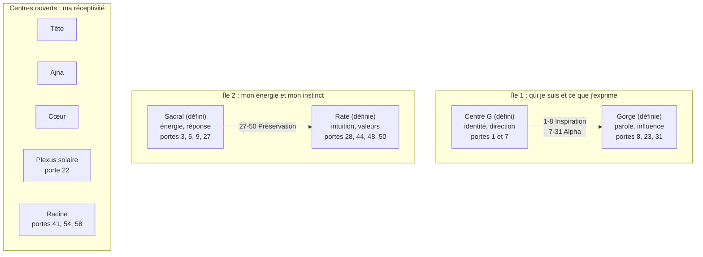

---
up:
  - "[[202603232257 mon human design]]"
  - "[[Autocoaching]]"
tags:
  - moi
  - autocoaching
  - human-design
created: 2026-11-13
source: "[[human_design_blueprint_pascal]]"
---
# Human Design 1 : mon profil

Né le 23/01/1977 à 9h45 à Avion. Cette note décrit mon design **pour lui-même**, sans le croiser avec l'Ennéagramme ou le reste.
Les autres notes : [[202611131906 human design 2 - impact sur mon projet|2. Impact sur mon projet]] · [[202611131907 human design 3 - convergences avec ma connaissance de moi|3. Convergences]] · [[202611131908 human design 4 - synthese de travail et pistes d'evolution|4. Synthèse de travail]].

> [!warning] Une grille de lecture
> Le Human Design n'est pas validé scientifiquement. Je le lis comme un langage pour mieux me comprendre, et je garde ce qui résonne avec mon expérience.

> [!info]- Note sur les données
> Le tableau des activations planétaires du blueprint contient des incohérences : il annonce le canal 1-8 alors qu'aucune planète du tableau n'active les portes 1 et 8. J'ai recalculé le design avec les éphémérides (Swiss Ephemeris, date du Design au 28/10/1976). Type, stratégie, autorité, profil, croix, canaux et centres sont **identiques** au blueprint. Seules certaines **portes** diffèrent. Cette note s'appuie sur le recalcul. Les variables (digestion, environnement…) viennent du blueprint et n'ont pas pu être vérifiées. Pour trancher, comparer avec un graphe officiel (Jovian Archive, myBodyGraph).

## Vue d'ensemble

| Élément | Mon design | En une phrase |
|---|---|---|
| Type | **Générateur** | Une énergie de vie durable, qui se renouvelle quand je fais ce qui m'allume |
| Stratégie | **Répondre** | Je trouve mon chemin en réagissant à ce que la vie me présente |
| Autorité | **Sacrale** | Mon corps sait, ici et maintenant, par un oui ou un non viscéral |
| Signature | **Satisfaction** | Le sentiment d'avoir bien utilisé mon énergie |
| Thème du non-soi | **Frustration** | Le signal que je force ou que je me suis engagé sans élan |
| Profil | **2/4, Ermite / Opportuniste** | Des dons naturels qui mûrissent dans la retraite, et qui se partagent à travers mes liens |
| Définition | **Split** (deux îles) | Deux circuits d'énergie distincts, que les autres et certains lieux relient |
| Croix d'incarnation | **Angle droit de l'Inattendu** (41/31, 28/27) | Une vie faite d'imprévus, où je guide et prends soin des autres |
| Centres définis | G, Gorge, Sacral, Rate | Identité, parole, énergie, instinct : ce qui est stable en moi |
| Centres ouverts | Tête, Ajna, Cœur, Plexus solaire, Racine | Là où je suis réceptif aux autres, et où peut naître une sagesse |

## 1. Mon type : Générateur

Les Générateurs sont environ 37 % de la population. C'est le type qui porte **l'énergie de vie** : celle qui construit, entretient, approfondit. Mon centre Sacral est défini, ce qui veut dire que j'ai accès en continu à une énergie de travail et de création renouvelable.

**Ce qui me caractérise :**
- **Une aura ouverte et enveloppante.** Elle attire les gens et les situations vers moi. Je n'ai pas besoin d'aller chercher : ce qui me correspond tend à venir.
- **Une grande endurance quand c'est le bon travail.** Absorbé dans ce qui m'allume, je peux travailler longtemps, avec plaisir, et finir la journée fatigué mais content.
- **Une énergie qui se recharge.** Utilisée pleinement dans la journée, elle se renouvelle la nuit. Ce qui m'épuise n'est pas l'effort, c'est l'effort sans élan.
- **La maîtrise par l'approfondissement.** Le Générateur devient maître de ce qu'il fait en le répétant et en l'approfondissant. Il traverse des plateaux, puis franchit un palier. Ces plateaux ne sont pas des échecs : c'est le temps où la maîtrise s'installe.

## 2. Ma stratégie : répondre

Répondre ne veut pas dire attendre passivement. Je suis tout le temps en contact avec le monde : une conversation, une question, une demande, une lecture, une proposition. **Ma stratégie, c'est de laisser ces stimulations venir, puis de sentir si mon corps y répond.**

- **Initier** : « je devrais lancer un podcast, ce serait bien pour mon activité. » L'idée vient de la tête.
- **Répondre** : quelqu'un me pose une question, et je sens tout de suite un élan, l'envie d'en parler. L'énergie vient du corps.

Quand je réponds, les portes s'ouvrent plus facilement, et j'ai l'énergie de mener les choses à leur terme. Je n'ai pas besoin d'un plan sur cinq ans : il suffit de répondre à la prochaine étape qui se présente.

## 3. Mon autorité : sacrale

C'est ma boussole intérieure pour décider. Elle se trouve dans le ventre et parle dans l'instant, par des sensations et des sons, pas par des raisonnements.

- **Le oui** : un élan vers, de la chaleur, de l'expansion, un « mm-hmm » spontané.
- **Le non** : une contraction, une lourdeur, un retrait, un « hun-hun », ou rien.
- **Pas maintenant** : aucun mouvement, juste qu'il n'y a pas encore de quoi répondre.

Le mental reste précieux pour comprendre, chercher, analyser, communiquer. Mais selon le Human Design, il n'est pas fait pour décider de ma vie. Les questions fermées (oui/non), surtout posées par quelqu'un d'autre, aident le Sacral à parler avant la tête.

## 4. Signature et non-soi

- **La satisfaction** est mon indicateur de justesse : être absorbé, perdre la notion du temps, finir la journée avec le sentiment d'avoir bien employé mon énergie, même fatigué.
- **La frustration** est mon voyant d'alerte, pas un défaut. Elle me dit que j'ai lancé quelque chose depuis la tête, que j'ai dit oui sans élan, ou que je n'ai pas respecté mon besoin de retraite. Elle invite à revenir à la réponse.

## 5. Ma définition : split, deux îles

Mes quatre centres définis forment deux circuits qui ne se touchent pas :

- **Île 1, identité et expression** : le Centre G (qui je suis, ma direction) relié à la Gorge (ma parole). Ce que je suis s'exprime naturellement en mots et en influence.
- **Île 2, énergie et instinct** : le Sacral (ma force de vie) relié à la Rate (mon intuition, ma santé, mes valeurs). Mon énergie est guidée par un instinct de protection et de soin.

**Ce que ça implique :**
- Je recherche naturellement des personnes et des environnements qui **relient mes deux îles**. Avec eux, je me sens plus entier, plus fluide. Une seule porte suffit à faire le pont chez l'autre : la **15** ou la **16**. D'autres le font à deux portes (2 et 14, 10 et 34, 20 et 57, 29 et 46…).
- Pour les grandes décisions, **prendre un peu de temps** aide : une définition split peut ressentir une légère pression à se « compléter » vite.
- **Les lieux animés** (café, bibliothèque, espace partagé) peuvent faire le pont temporairement et apporter de la fluidité.

## 6. Mon profil : 2/4, l'Ermite et l'Opportuniste

Le profil décrit ma manière d'apprendre, de vivre et de rencontrer les autres. Le **2** est ma part consciente, le **4** ma part inconsciente (celle que mon corps vit et que les autres voient).

### Ligne 2 : l'Ermite (conscient)
- **Des dons naturels.** Certaines choses me viennent si facilement que je ne mesure pas qu'elles sont rares. Ce sont souvent les autres qui me les montrent.
- **Un besoin de retraite.** J'ai besoin de temps seul, sans attentes extérieures, pour me ressourcer et être pleinement moi. C'est là que mes dons mûrissent.
- **Être appelé.** Quand je suis dans mon espace, à faire ce que j'aime, les bonnes personnes remarquent ce que je fais et m'appellent à le partager. La reconnaissance vient de l'extérieur.

### Ligne 4 : l'Opportuniste (inconscient)
- **Le réseau.** Mes opportunités, professionnelles comme amoureuses, passent par les personnes que je connais : amis, collègues, connaissances de confiance.
- **La chaleur et l'influence.** Les gens se sentent bien avec moi et me font confiance. Je construis des liens durables.
- **Une base stable.** Je fonctionne mieux quand je ne coupe pas les ponts, et que je passe d'un chapitre à l'autre en gardant mes relations.

### L'équilibre du 2/4
Protéger mon temps d'ermite pour que, quand je vais vers les autres, j'apporte de la vitalité plutôt que de la fatigue sociale. Les deux sont nécessaires : la retraite nourrit le don, le réseau le fait circuler.

## 7. Ma croix : l'Angle droit de l'Inattendu

La croix d'incarnation décrit le thème de vie. La mienne réunit quatre portes : **41 et 31** (mon Soleil et ma Terre conscients), **28 et 27** (mon Soleil et ma Terre inconscients). Une croix à « angle droit » décrit un chemin **personnel**, qui se vit à travers mes propres expériences et rencontres.

- **41, l'élan** : l'imagination, le désir de vivre de nouvelles expériences, l'énergie qui lance un nouveau cycle.
- **31, l'influence** : la capacité à guider, à porter une direction quand on me la confie.
- **28, le sens** : chercher ce qui vaut vraiment la peine, s'engager dans des défis qui donnent du sens à la vie.
- **27, le soin** : nourrir, protéger, prendre soin des personnes et des projets auxquels je tiens.

**Le thème** : une vie marquée par des **changements inattendus**. Ma façon d'y répondre, c'est d'apporter du soin et une direction, en particulier quand les choses se désorganisent. Je peux aider les autres à trouver du sens dans ce qui ne se passe pas comme prévu.

## 8. Mes canaux : trois talents permanents

Un canal relie deux centres. C'est une force fiable, toujours disponible.

### 7-31, le canal de l'Alpha (Centre G → Gorge)
- **Un leadership de vision.** Je vois où les choses vont et je peux formuler une direction claire pour un groupe.
- **Un leadership choisi.** Il s'agit d'un leadership « démocratique » : il fonctionne quand il est **reconnu et invité** par les autres. Quand on me demande d'orienter, ma parole porte naturellement.
- La porte 7 est activée à la fois consciemment et inconsciemment : ce rôle de guide est profondément ancré.

### 1-8, le canal de l'Inspiration (Centre G → Gorge)
- **Un rôle modèle créatif.** J'inspire les autres simplement en vivant et en créant à ma façon, sans prêcher ni convaincre.
- **Un talent entièrement inconscient** : les deux portes sont dans mon Design. Ce sont surtout les autres qui le voient, plus que moi. C'est cohérent avec ma ligne 2.

### 27-50, le canal de la Préservation (Sacral → Rate)
- **Un gardien.** Une énergie instinctive pour prendre soin, protéger et nourrir les personnes, les valeurs et les communautés auxquelles je tiens.
- **Un sens moral.** Un sens aigu de ce qui est juste, et de la responsabilité envers les autres.
- **Une vigilance** : garder des limites saines, pour ne pas donner au-delà de mes ressources.

## 9. Mes centres

### Les centres définis : ce qui est stable en moi

- **Centre G, identité et direction** : un sentiment stable de qui je suis et de ma direction. Je n'ai pas besoin de chercher mon identité à l'extérieur, et cette stabilité rassure les autres.
- **Sacral, énergie de vie** : ma force de travail et de création, qui se renouvelle quand je suis engagé dans ce qui m'allume.
- **Rate, intuition et instinct** : un radar fiable, dans l'instant, pour la santé, la sécurité, la valeur des choses et le potentiel des gens. Elle parle doucement et une seule fois : l'enjeu est de l'écouter sur le moment.
- **Gorge, parole** : reliée au Centre G, ma parole est la plus juste et la plus forte quand elle vient de mon identité et de mon expérience vécue.

### Les centres ouverts : ma réceptivité et ma sagesse potentielle

Un centre ouvert n'est pas un manque. C'est un endroit où je reçois et amplifie l'énergie des autres. Il peut devenir un lieu de **conditionnement** (quand je prends ces énergies pour les miennes) ou de **sagesse** (quand je les observe sans m'y identifier). Trois de mes centres ouverts sont **entièrement ouverts** (aucune porte) : la Tête, l'Ajna et le Cœur. Ils sont particulièrement libres.

| Centre | La question du conditionnement | La sagesse possible |
|---|---|---|
| **Tête** (inspiration) | Est-ce que je pense à des questions qui ne me concernent pas ? | Être inspiré par les idées sans me sentir obligé d'y répondre |
| **Ajna** (pensée, certitude) | Est-ce que j'essaie de convaincre que je suis certain ? | Une grande souplesse mentale : voir et comprendre de multiples façons de penser |
| **Cœur** (volonté, valeur) | Est-ce que j'essaie de prouver ma valeur ? | Savoir que je n'ai rien à prouver, et reconnaître qui est vraiment fiable |
| **Plexus solaire** (émotions) | Est-ce que j'évite la confrontation et la vérité ? | Une empathie profonde, sentir les émotions des autres sans m'y noyer |
| **Racine** (pression, élan) | Est-ce que je me presse pour me débarrasser de la pression ? | Rester posé sous la pression, et sentir quelle pression vaut la peine |

## 10. Mes portes : mes thèmes et mes talents

Chaque porte est un thème ou un talent particulier. **Conscient** (Personnalité) : ce que je connais de moi. **Inconscient** (Design) : ce que mon corps vit et que les autres perçoivent.

### Les portes de mes canaux

| Porte | Thème | Où | Ce qu'elle apporte |
|---|---|---|---|
| **1** Le Créatif | Expression de soi | Inconscient (Mars) | Le besoin d'exprimer ma singularité de façon créative |
| **8** La Contribution | Montrer l'exemple | Inconscient (Jupiter) | Contribuer en montrant ce qui est singulier, en être l'exemple |
| **7** Le Rôle du Soi | Guider | Conscient et inconscient (Saturne) | Orienter un groupe vers l'avenir |
| **31** L'Influence | Diriger | Conscient (Terre) | Un leadership reconnu par les autres |
| **27** Le Soin | Nourrir | Inconscient (Terre, Nœud Sud) | Prendre soin, la générosité, nourrir ce qui grandit |
| **50** Les Valeurs | Le gardien | Conscient (Nœud Nord) et inconscient (Mercure) | Protéger les valeurs et les règles qui font tenir une communauté |

### Les portes qui se répètent : mes thèmes forts

- **28, Le Joueur (trois fois, inconscient : Soleil, Uranus, Nœud Nord)** : trouver ce qui vaut la peine de se battre, donner du sens à la vie. Une lutte pour le sens, et la capacité à s'engager pleinement dans un défi qui en vaut la peine.
- **54, L'Ambition (conscient : Mars ; inconscient : Lune)** : le désir de s'élever, de progresser, de transformer sa situation, sur le plan matériel comme intérieur. Une énergie qui pousse à aller plus haut.
- **48, La Profondeur (conscient et inconscient : Pluton)** : une profondeur naturelle, le talent de trouver des solutions de fond. Avec parfois la peur de ne pas en savoir assez.
- **22, La Grâce (conscient : Lune et Vénus)** : la grâce sociale, le charme, l'ouverture, l'art d'écouter. Une sensibilité aux émotions et à la beauté.
- **5, Les Rythmes (conscient et inconscient : Neptune)** : le besoin de rythmes réguliers. Mon énergie fonctionne mieux avec des routines naturelles.

### Les autres portes

- **41, La Contraction (Soleil conscient)** : mon énergie centrale. L'imagination, le rêve, le désir de nouvelles expériences. C'est la porte qui lance un nouveau cycle.
- **58, La Vitalité (Mercure conscient)** : la joie de vivre et le désir d'améliorer ce qui peut l'être. Une parole animée par la joie de rendre les choses meilleures.
- **23, L'Assimilation (Jupiter conscient)** : le talent de traduire des intuitions singulières en mots simples. Pour être entendu, cette parole a besoin du bon moment : quand on me la demande.
- **44, La Vigilance (Uranus conscient)** : le flair pour les schémas qui viennent du passé et pour le potentiel des personnes. Savoir reconnaître qui peut faire quoi.
- **3, L'Ordonnancement (Nœud Sud conscient)** : mettre de l'ordre dans ce qui est nouveau, innover à partir du chaos.
- **9, Le Focus (Vénus inconsciente)** : la capacité de concentration sur le détail qui compte.

### Les portes « suspendues » : ce que je cherche chez les autres

Une porte qui n'est pas dans un canal cherche sa porte complémentaire chez les autres : c'est une forme d'attirance. Par exemple, ma **41** (l'élan des nouvelles expériences) cherche la **30** (le désir, le feu émotionnel), ma **23** (dire des intuitions) cherche la **43** (les avoir), ma **5** (le rythme) cherche la **15** (qui ferait aussi le pont entre mes deux îles), ma **48** (la profondeur) cherche la **16** (le talent mis en œuvre, qui relierait aussi mes deux îles).

## 11. Mes variables (selon le blueprint, à vérifier)

- **Digestion froide** : j'assimile mieux, nourriture comme information, dans le calme et sans surchauffe.
- **Sens : le ressenti** : je perçois l'atmosphère des lieux, des matières, des personnes.
- **Motivation : l'espoir** : une confiance tranquille dans le fait que les choses arrivent en leur temps. Son ombre : la culpabilité, se sentir responsable de tout.
- **Perspective : personnelle** : regarder la vie à partir de mon expérience directe et de mon cercle proche. Son ombre : se fixer sur les jeux de pouvoir.
- **Environnement : montagnes** : hauteur, vue dégagée, air frais, calme.

## 12. Les grands âges du design

Le Human Design décrit, pour tout le monde, un tournant vers **50 ans** (le « retour de Chiron ») : le moment où l'on peut commencer à vivre plus pleinement son design, et à transmettre ce que l'on a appris. J'aurai 50 ans en janvier 2027.

## En résumé

Je suis un **moteur généreux** : une énergie durable, qui se renouvelle quand elle répond à ce qui l'allume. J'ai une **identité stable** qui s'exprime en paroles et en influence, et qui inspire par l'exemple. J'ai un **instinct de gardien**, tourné vers le soin, la protection et les valeurs. J'ai **besoin de retraite** pour que mes dons mûrissent, et mes **liens** pour les faire circuler. Mes centres ouverts me donnent une **grande réceptivité** : à la pensée des autres, à leurs émotions, à leur pression. C'est un terrain de sagesse possible, à condition de ne pas les prendre pour les miennes.
